# Diagramas de Classes do Sistema

Este documento apresenta a modelagem de classes do **Sistema de Gestão de Hotelaria**. O sistema utiliza o padrão arquitetural **MVC (Model-View-Controller)**.

---

## 1. Diagrama de Classes Geral (Mermaid)

```mermaid
classDiagram
    direction TB

    namespace Models_Dominio {
        class Cliente {
            -_id : int | None
            -_nome : str
            -_cpf : str
            -_telefone : str
            -_email : str
            +get_id() int
            +set_id(id: int) void
            +get_nome() str
            +get_cpf() str
            +get_telefone() str
            +get_email() str
        }

        class Quarto {
            +TIPOS : list~str~
            -_numero : int
            -_tipo : str
            -_valor_diaria : float
            +estado : EstadoContexto
            +get_numero() int
            +get_tipo() str
            +get_valor_diaria() float
        }

        class Reserva {
            -_id : int | None
            -_hospede : Cliente
            -_data_checkin : date
            -_data_checkout : date
            +hospede : Cliente
            +data_checkin : date
            +data_checkout : date
        }

        class Estadia {
            -_id : int | None
            -_hospede : Cliente
            -_quarto : Quarto
            -_data_checkin : datetime
            -_data_checkout : datetime
            -_fatura : Fatura
            +obter_total() float
            +adicionar_item(item: ItemFatura) void
        }

        class Item {
            -_id : int
            -_nome : str
            -_preco : float
            +id : int
            +nome : str
            +preco : float
        }

        class ItemFatura {
            -_id : int
            -_item : Item
            -_quantidade : int
            +id : int
            +item : Item
            +quantidade : int
        }

        class Fatura {
            -_id_estadia : int
            -_itens : list~ItemFatura~
            +adicionar_item(item: ItemFatura) void
            +calcular_total() float
        }
    }

    namespace Padrao_State {
        class EstadoContexto {
            -_state : Estado
            +set_estado(novo_estado: Estado) void
            +reservar(quarto: Quarto) void
            +check_in(quarto: Quarto) void
            +check_out(quarto: Quarto) void
            +iniciar_manutencao(quarto: Quarto) void
            +finalizar_manutencao(quarto: Quarto) void
            +finalizar_limpeza(quarto: Quarto) void
            +obter_atual() str
        }

        class Estado {
            <<abstract>>
            +reservar(quarto: Quarto)* void
            +check_in(quarto: Quarto)* void
            +check_out(quarto: Quarto)* void
            +iniciar_manutencao(quarto: Quarto)* void
            +finalizar_manutencao(quarto: Quarto)* void
            +finalizar_limpeza(quarto: Quarto)* void
            +obter_atual()* str
        }

        class Disponivel {
            +reservar(quarto: Quarto) void
            +check_in(quarto: Quarto) void
            +iniciar_manutencao(quarto: Quarto) void
            +obter_atual() str
        }

        class Reservado {
            +check_in(quarto: Quarto) void
            +obter_atual() str
        }

        class Ocupado {
            +check_out(quarto: Quarto) void
            +obter_atual() str
        }

        class Limpeza {
            +iniciar_manutencao(quarto: Quarto) void
            +finalizar_limpeza(quarto: Quarto) void
            +obter_atual() str
        }

        class Manutencao {
            +finalizar_manutencao(quarto: Quarto) void
            +obter_atual() str
        }
    }

    namespace Repositorios {
        class ClienteRepositorio {
            <<interface>>
            +salvar(cliente: Cliente)* void
            +remover(cpf_cliente: str)* bool
            +obter_todos()* list~Cliente~
            +buscar_por_id(id_busca: int)* Cliente
            +buscar_por_cpf(cpf_busca: str)* Cliente
            +atualizar(cliente: Cliente)* bool
        }

        class ClienteRepositorioMemoria {
            -_clientes : list~Cliente~
            -_proximo_id : int
            +salvar(cliente: Cliente) void
            +remover(cpf_cliente: str) bool
            +obter_todos() list~Cliente~
            +buscar_por_id(id_busca: int) Cliente
            +buscar_por_cpf(cpf_busca: str) Cliente
        }

        class QuartoRepositorio {
            <<interface>>
            +adicionar(quarto: Quarto)* void
            +remover(numero_busca: int)* bool
            +listar()* list~Quarto~
            +buscar_por_numero(numero_busca: int)* Quarto
            +obter_tipos()* list~str~
        }

        class QuartoRepositorioMemoria {
            -_quartos : list~Quarto~
            +adicionar(quarto: Quarto) void
            +remover(numero_busca: int) bool
            +listar() list~Quarto~
            +buscar_por_numero(numero_busca: int) Quarto
            +obter_tipos() list~str~
        }

        class EstadiaRepositorio {
            <<interface>>
            +obter_proximo_id()* int
            +salvar(estadia: Estadia)* void
            +remover(id_cliente: int)* bool
            +obter_fatura(id_estadia: int)* Fatura
            +adicionar_item_fatura(id_estadia: int, item: ItemFatura)* void
            +buscar_por_id(id_busca: int)* Estadia
            +buscar_por_cpf(cpf_busca: str)* Estadia
            +obter_reservas_por_data(data: date)* list~Estadia~
        }
    }

    namespace Controllers {
        class ClienteController {
            -_repo : ClienteRepositorio
            +cadastrar(nome: str, cpf: str, telefone: str, email: str) str
            +listar() list~Cliente~
            +remover(cpf: str) str
        }

        class QuartoController {
            -_repo : QuartoRepositorio
            +cadastrar(numero_str: str, tipo: str, valor_str: str) str
            +listar() list~Quarto~
            +remover(numero_str: str) str
            +obter_nome_estado(quarto: Quarto) str
            +obter_tag_estado(quarto: Quarto) str
        }

        class EstadiaController {
            -_cliente_repo : ClienteRepositorio
            -_quarto_repo : QuartoRepositorio
            +realizar_reserva(cliente: Cliente, quarto: Quarto, data_inicio: date, data_fim: date) void
            +adicionar_cliente_estadia(estadia: Estadia, cliente: Cliente) void
            +adicionar_quarto_estadia(estadia: Estadia, quarto: Quarto) void
            +remover_cliente_estadia(estadia: Estadia, cliente: Cliente) void
            +remover_quarto_estadia(estadia: Estadia, quarto: Quarto) void
            +check_in(estadia: Estadia, data_checkin: datetime) void
            +check_out(estadia: Estadia, data_checkout: datetime) void
            +obter_todas_estadias() void
            +obter_todas_reservas() void
        }
    }

    %% Relacionamentos do Domínio
    Reserva "0..*" --o "1" Cliente : reserva para
    Estadia "0..*" --o "1" Cliente : hóspede
    Estadia "0..*" --o "0..1" Quarto : alocado em
    Estadia "1" *-- "1" Fatura : possui
    Fatura "1" *-- "0..*" ItemFatura : contém
    ItemFatura "0..*" --o "1" Item : refere-se a

    %% Relacionamentos do State Pattern
    Quarto "1" *-- "1" EstadoContexto : possui estado
    EstadoContexto "1" o-- "1" Estado : estado atual
    Estado <|-- Disponivel : implementa
    Estado <|-- Reservado : implementa
    Estado <|-- Ocupado : implementa
    Estado <|-- Limpeza : implementa
    Estado <|-- Manutencao : implementa

    %% Relacionamentos de Repositórios
    ClienteRepositorio <|.. ClienteRepositorioMemoria : realiza
    QuartoRepositorio <|.. QuartoRepositorioMemoria : realiza

    %% Relacionamentos de Controllers
    ClienteController "1" --> "1" ClienteRepositorio : utiliza
    QuartoController "1" --> "1" QuartoRepositorio : utiliza
    EstadiaController "1" --> "1" ClienteRepositorio : utiliza
    EstadiaController "1" --> "1" QuartoRepositorio : utiliza
```

